 

# Hi, I'm Vinod Jangid 👋

Frontend developer. I build interfaces and the products around them.

 

 

 

## ✨ About me

I'm a frontend developer. I work with React, Next.js, Astro and Node.js.

I like building small things on the side, and a few of them end up on [Uiverse](https://uiverse.io/profile/vinodjangid07) and [CodePen](https://codepen.io/vinodjangid07).

If you're working on something and could use a frontend dev, [email me](mailto:infovinodjangid@gmail.com). My [portfolio](https://www.vinodjangid.site/) has the rest.

 

## 🚀 Featured project

<table>
<tr>
<td>

### almost · *almost yours*

An intentional wishlist manager with a quiet luxury feel. Tag wishes as Need, Want or Luxury, see the live gap between your savings and your targets, and pool funds with friends using invite codes.

**Next.js 16** · **TypeScript** · **Tailwind CSS v4** · **Firebase** · **Vercel Blob**

[**View live →**](https://almost.vinodjangid.site)

</td>
</tr>
</table>

 

## 🛠 Tech stack

  

 

## 📊 GitHub stats

  

  

### 🔝 Top Contributed Repo

 

## 🌐 Find me elsewhere

 

### ☕ Support my work

 

Built with care. Thanks for stopping by.

